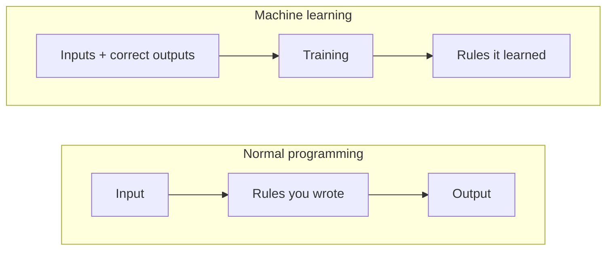
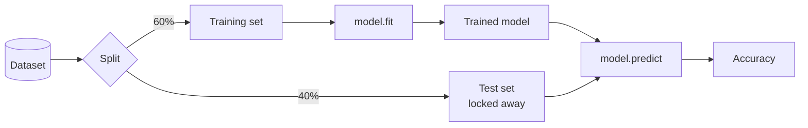
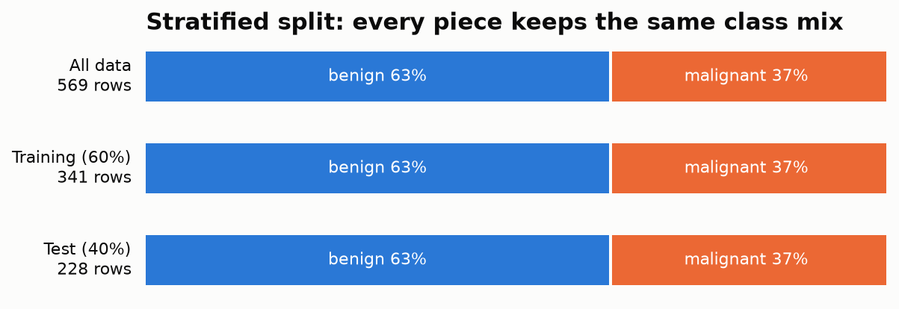
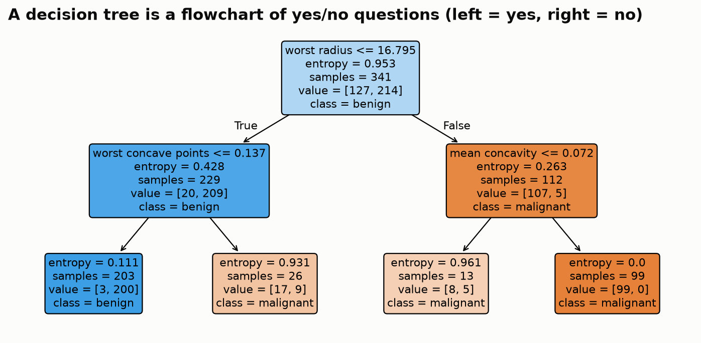
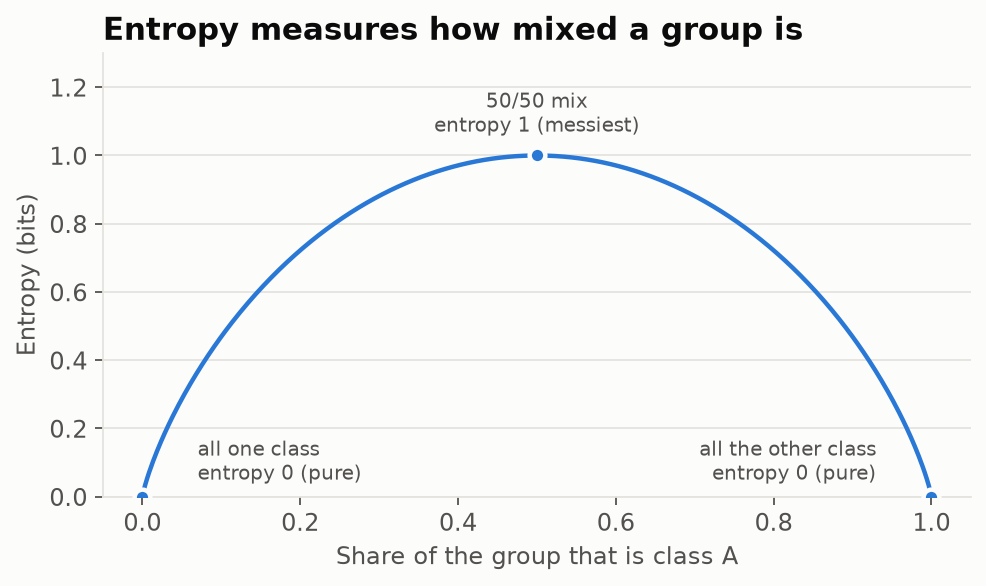
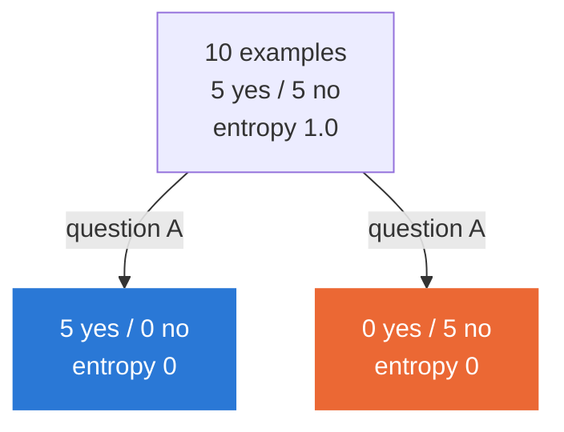
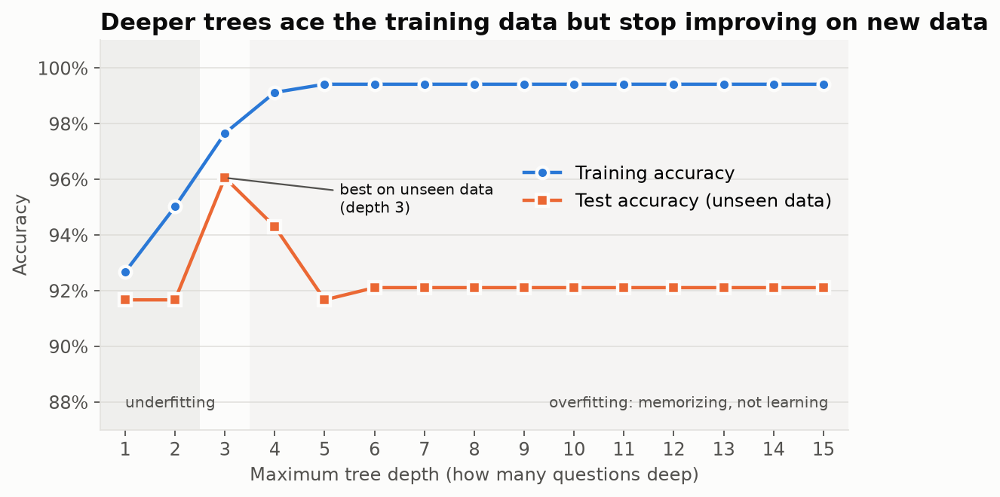
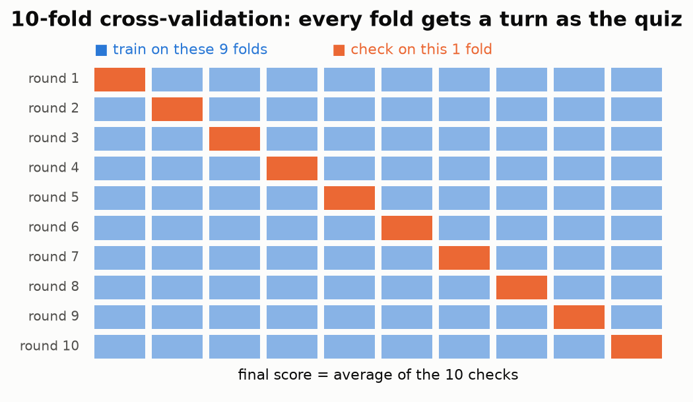

# Breast Cancer Decision Tree

Teaching a computer to tell **benign** from **malignant** tumors using a decision tree.
Explained for developers who have never touched ML. If you can write a function, you can follow this.

| 569 | 30 | 92% | 4 |
|:-:|:-:|:-:|:-:|
| tumor samples | measurements each | test accuracy | best tree depth |

<sub>Data: Breast Cancer Wisconsin (Diagnostic) [[1]](#references). Each row describes cell nuclei measured from a digitized image of a breast mass biopsy.</sub>

---

## ML in one picture

Normal programming: **you** write the rules.
Machine learning: you give **examples**, and the computer figures out the rules.



## Translation table: ML words for developers

| ML term | What it means in dev terms |
|---|---|
| **Dataset** | A table (think CSV) |
| **Instance** | One row |
| **Feature** | One column (an input) |
| **Label / target** | The answer column you want to predict |
| **Model** | A function learned from examples instead of written by hand |
| **Training** | Running the learning step: `model.fit(X, y)` |
| **Prediction** | Calling the learned function: `model.predict(X)` |
| **Hyperparameter** | A config setting you choose before training |
| **Accuracy** | % of predictions that were right |

## The whole workflow



In code, almost every model in scikit-learn looks like this:

```python
model = SomeModel(setting_a=..., setting_b=...)  # 1. configure
model.fit(X_train, y_train)                      # 2. learn from examples
predictions = model.predict(X_test)              # 3. predict on new data
accuracy_score(y_test, predictions)              # 4. how often was it right?
```

---

## Core ideas

### 1. Never grade on the practice questions

A model tested on data it trained on will look better than it really is.
So we **hide some data** (the test set) and only use it at the very end.

**Stratified** splitting makes sure each piece has the same mix of classes as the whole dataset:



### 2. A decision tree is a flowchart

The model learns a series of yes/no questions. Each leaf gives an answer.



> Read `value = [127, 214]` as "127 malignant, 214 benign reached this box."

### 3. How the tree picks its questions: entropy

**Entropy** scores how mixed a group is. 0 = all the same, 1 = a perfect 50/50 mess.



```
entropy = -Σ p · log₂(p)          (p = share of each class)
```

The tree tries every possible question and keeps the one that makes the groups **least mixed**.
That drop in entropy is called **information gain**.



> Question A takes entropy from 1.0 to 0: information gain of 1.0, the best possible split.

### 4. Overfitting: memorizing instead of learning

Let a tree grow deeper and it will eventually memorize the training data (nearly 100%).
But it gets **worse** on data it has never seen. The sweet spot is in the middle.



### 5. Tuning settings without cheating: cross-validation

If you pick settings based on the test set, the test set is no longer "unseen."
Instead, rotate through the **training** data: each slice takes a turn as a mini test.



`GridSearchCV` does this for every combination of settings and keeps the winner.

---

## Go deeper: build a tree by hand

No libraries, just the math. Every entropy and information gain calculation, step by step.

➡️ **[Growing a decision tree by hand](docs/tree_by_hand.md)**

---

## Run it yourself

```bash
python3 -m venv .venv
source .venv/bin/activate
pip install scikit-learn matplotlib
python docs/make_figures.py      # regenerates every image in this README
```

Built with [scikit-learn](https://scikit-learn.org) and [matplotlib](https://matplotlib.org).

## References

1. W. H. Wolberg, W. N. Street, and O. L. Mangasarian, "Breast Cancer Wisconsin (Diagnostic)," UCI Machine Learning Repository, 1995. https://doi.org/10.24432/C5DW2B
