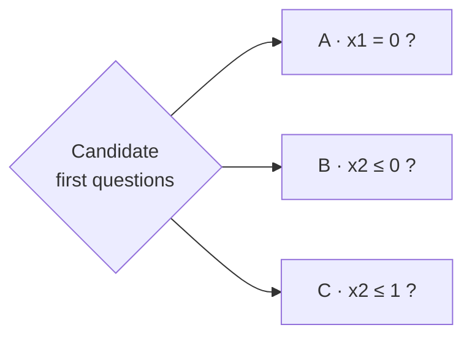
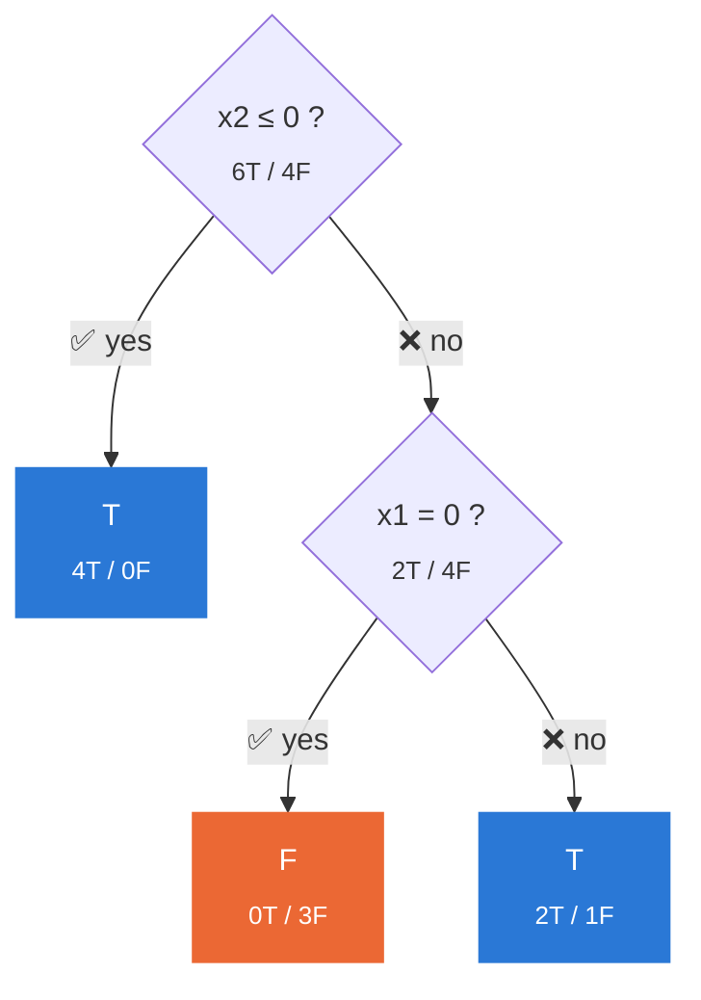

# Growing a Decision Tree by Hand

No libraries, just math. How a decision tree picks its questions, step by step.

---

## The data

10 examples. Two inputs (`x1`, `x2`), one answer (`y`).

| Row | x1 | x2 | y |
|:-:|:-:|:-:|:-:|
| 1 | 0 | 0 | 🟦 T |
| 2 | 0 | 0 | 🟦 T |
| 3 | 1 | 0 | 🟦 T |
| 4 | 1 | 0 | 🟦 T |
| 5 | 0 | 1 | 🟧 F |
| 6 | 0 | 1 | 🟧 F |
| 7 | 1 | 1 | 🟦 T |
| 8 | 1 | 2 | 🟦 T |
| 9 | 0 | 2 | 🟧 F |
| 10 | 1 | 2 | 🟧 F |

- `x1` is binary: 0 or 1
- `x2` is ordered: 0 < 1 < 2
- `y` is the answer: **T** (true) or **F** (false)

## The rules

| Rule | Meaning |
|---|---|
| Binary tree | Every question has exactly 2 answers |
| Min 6 to split | Groups smaller than 6 become leaves |
| No repeats | An input is used once per path |
| Majority vote | A leaf predicts its most common answer |

---

## The only two equations

**Entropy**: how mixed a group is. 0 = pure, 1 = 50/50 [[1]](#references)

$$H(S) = -\sum_{i} p_i \log_2 p_i$$

**Information gain**: how much a split un-mixes things. Higher is better [[2]](#references)[[3]](#references)

$$IG = H(\text{parent}) - \sum_{\text{child}} \frac{\text{child size}}{\text{parent size}} \cdot H(\text{child})$$

> `p` = fraction of the group in each class. `0 · log₂0` counts as 0.

📐 log₂ cheat sheet

| p | log₂(p) |
|:-:|:-:|
| 0.2 | -2.322 |
| 0.286 (2/7) | -1.807 |
| 0.333 (1/3) | -1.585 |
| 0.4 | -1.322 |
| 0.6 | -0.737 |
| 0.667 (2/3) | -0.585 |
| 0.714 (5/7) | -0.485 |
| 0.8 | -0.322 |

---

## Step 1: How mixed is the whole set?

🟦 6 T  🟧 4 F

$$H = -(0.6 \log_2 0.6 + 0.4 \log_2 0.4) = 0.442 + 0.529 = \mathbf{0.971}$$

Pretty mixed. Let's find a question that separates them.

---

## Step 2: What questions can we ask?

`x2` is ordered, so cuts must respect 0 < 1 < 2.

---

## Step 3: Score each question

### A · `x1 = 0 ?`

| Branch | Rows | Mix |
|---|---|---|
| yes | 1, 2, 5, 6, 9 | 🟦🟦🟧🟧🟧 |
| no | 3, 4, 7, 8, 10 | 🟦🟦🟦🟦🟧 |

$$H_{yes} = -(0.4 \log_2 0.4 + 0.6 \log_2 0.6) = 0.971$$

$$H_{no} = -(0.8 \log_2 0.8 + 0.2 \log_2 0.2) = 0.258 + 0.464 = 0.722$$

$$IG_A = 0.971 - \left(\tfrac{5}{10} \cdot 0.971 + \tfrac{5}{10} \cdot 0.722\right) = 0.971 - 0.846 = \mathbf{0.125}$$

### B · `x2 ≤ 0 ?`

| Branch | Rows | Mix |
|---|---|---|
| yes | 1, 2, 3, 4 | 🟦🟦🟦🟦 |
| no | 5, 6, 7, 8, 9, 10 | 🟧🟧🟦🟦🟧🟧 |

$$H_{yes} = 0 \quad \text{(pure)}$$

$$H_{no} = -\left(\tfrac{1}{3} \log_2 \tfrac{1}{3} + \tfrac{2}{3} \log_2 \tfrac{2}{3}\right) = 0.528 + 0.390 = 0.918$$

$$IG_B = 0.971 - \left(\tfrac{4}{10} \cdot 0 + \tfrac{6}{10} \cdot 0.918\right) = 0.971 - 0.551 = \mathbf{0.420}$$

### C · `x2 ≤ 1 ?`

| Branch | Rows | Mix |
|---|---|---|
| yes | 1 – 7 | 🟦🟦🟦🟦🟧🟧🟦 |
| no | 8, 9, 10 | 🟦🟧🟧 |

$$H_{yes} = -\left(\tfrac{5}{7} \log_2 \tfrac{5}{7} + \tfrac{2}{7} \log_2 \tfrac{2}{7}\right) = 0.347 + 0.516 = 0.863$$

$$H_{no} = -\left(\tfrac{1}{3} \log_2 \tfrac{1}{3} + \tfrac{2}{3} \log_2 \tfrac{2}{3}\right) = 0.918$$

$$IG_C = 0.971 - \left(\tfrac{7}{10} \cdot 0.863 + \tfrac{3}{10} \cdot 0.918\right) = 0.971 - 0.880 = \mathbf{0.091}$$

### 🏆 Scoreboard

| Question | Info gain | |
|---|:-:|---|
| A · x1 = 0 | 0.125 | ▇▇▇ |
| **B · x2 ≤ 0** | **0.420** | **▇▇▇▇▇▇▇▇▇▇** ← winner |
| C · x2 ≤ 1 | 0.091 | ▇▇ |

B creates a perfectly pure group right away.

---

## Step 4: Keep growing

| Node | Size | Can split? | Result |
|---|:-:|:-:|---|
| x2 = 0 | 4 | ❌ under 6 | Leaf **T** |
| x2 > 0 | 6 | ✅ | Split on **x1** (only input left) |

Splitting the right branch on `x1`:

| Branch | Rows | Mix |
|---|---|---|
| x1 = 0 | 5, 6, 9 | 🟧🟧🟧 |
| x1 = 1 | 7, 8, 10 | 🟦🟦🟧 |

$$IG = 0.918 - \left(\tfrac{3}{6} \cdot 0 + \tfrac{3}{6} \cdot 0.918\right) = \mathbf{0.459}$$

Both children have 3 rows, under 6, so they become leaves.

---

## The final tree

**9 / 10** training rows correct. Row 10 is the one miss: the stopping rules keep the tree small on purpose.

---

## References

1. C. E. Shannon, "A Mathematical Theory of Communication," *Bell System Technical Journal*, vol. 27, no. 3, pp. 379-423, 1948.
2. J. R. Quinlan, "Induction of Decision Trees," *Machine Learning*, vol. 1, no. 1, pp. 81-106, 1986.
3. T. M. Mitchell, *Machine Learning*, McGraw-Hill, 1997, ch. 3.
